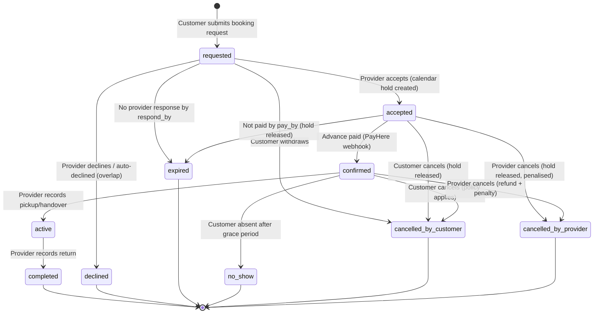
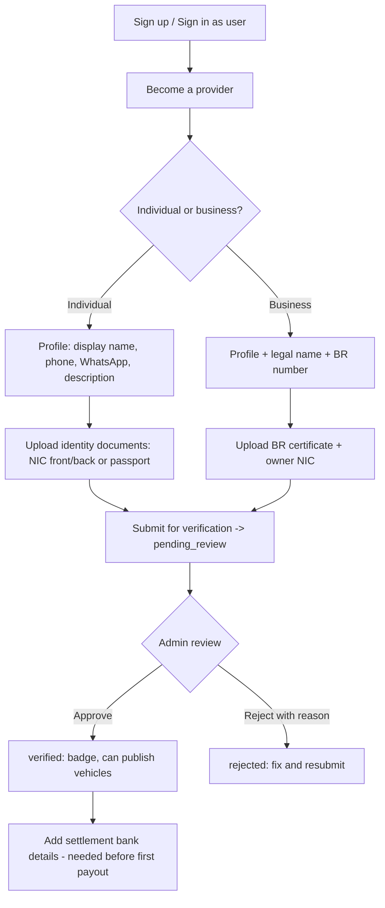

# User Flows

**Status:** Draft v0.1 for review (2026-10-02)
**Related:** [PRD.md](PRD.md), [DATABASE_DESIGN.md](DATABASE_DESIGN.md) §7 (booking lifecycle), [API_DESIGN.md](API_DESIGN.md)

Conventions: each flow lists the steps, the system behaviour at each step, the notifications fired, and the edge cases. Screens are named in `Title Case`; API endpoints are referenced by name only (details in API_DESIGN.md). "MVP" marks what ships in the first release; "Later" marks designed-for-but-deferred behaviour.

---

## 0. Booking lifecycle (shared by all flows)



Why this shape (and not the example list in the brief):

| Example state                      | Our treatment                                   | Reason                                                                                       |
| ---------------------------------- | ----------------------------------------------- | -------------------------------------------------------------------------------------------- |
| SEARCH                             | Not a booking state                             | Nothing exists in the DB yet                                                                 |
| BOOKING_REQUEST / PENDING_PROVIDER | Merged into `requested`                         | They describe the same waiting condition                                                     |
| CONFIRMED → PAYMENT_PENDING → PAID | `accepted` (awaiting payment) → `confirmed`     | A booking is only "confirmed" once money is in; naming it earlier misleads customers         |
| PICKUP / RETURN_PENDING            | Timestamps on `active`                          | They are moments, not waiting states with their own rules                                    |
| ACTIVE_RENTAL                      | `active`                                        |                                                                                              |
| DISPUTED                           | Overlay (`disputes` table + flag), not a state  | A dispute can exist on `completed`, `no_show` or `cancelled` bookings without rewinding them |
| REJECTED                           | `declined`                                      | Provider vocabulary                                                                          |
| EXPIRED                            | `expired` from either `requested` or `accepted` | Two timers: provider response, customer payment                                              |

Timers (platform settings): provider response window (default 24 h, shorter when pickup is near), payment window (default 24 h, capped at pickup time), no-show grace (default 3 h after `starts_at`).

---

## 1. Customer flows

### 1.1 Discover → Search

| #   | Step           | System behaviour                                                                                                                                                        | Notes                                                                                                                           |
| --- | -------------- | ----------------------------------------------------------------------------------------------------------------------------------------------------------------------- | ------------------------------------------------------------------------------------------------------------------------------- |
| 1   | Land on `Home` | Hero search box: _Where_ (place suggest or "Use my location"), _Pickup date/time_, _Return date/time_, _Category chips_. Popular launch towns shown as quick picks.     | SEO landing pages per town/category (`/rent/mirissa/scooters`) are generated from the same search.                              |
| 2   | Enter location | Typing queries the curated `places` gazetteer (no external API in MVP). "Use my location" calls browser geolocation; if denied, fall back to the place box with a hint. | Tourists outside Sri Lanka searching from abroad: geolocation is ignored if outside the island; show launch-region suggestions. |
| 3   | Pick dates     | Date-time pickers default to tomorrow 09:00 → +3 days 09:00, `Asia/Colombo`. Min duration 1 day; validation against vehicle `min_rental_days` happens per result.       | Dates are mandatory: without dates the platform cannot promise availability, which is the core value.                           |
| 4   | Submit         | Navigate to `Search Results` with query params in the URL (shareable).                                                                                                  |                                                                                                                                 |

**As implemented in Phase 5 (2026-10-04):** the home page carries the search box (place from the gazetteer, optional pickup/return days, vehicle type) and quick links to the launch towns; it navigates to `/search?placeId=…&startDate=…&endDate=…&categoryId=…`. Dates are optional in this phase (without them the list shows all discoverable vehicles and no availability promise); "use my location" and place type-ahead are deferred (`GET /places/suggest` exists for the next iteration).

### 1.2 Search Results → Filter → Compare

| #   | Step              | System behaviour                                                                                                                                                                                                                                                                                                                                                                                             |
| --- | ----------------- | ------------------------------------------------------------------------------------------------------------------------------------------------------------------------------------------------------------------------------------------------------------------------------------------------------------------------------------------------------------------------------------------------------------ |
| 5   | Results load      | `Search vehicles` returns only vehicles **free for the whole window** within the radius (default 15 km from the place centre or the user's point). Each card: primary photo, make/model/year, category, transmission, seats, distance, provider name + verification badge, rating, **total price for the requested period**, per-day equivalent, deposit, "Self-drive / With driver", pickup/delivery icons. |
| 6   | Toggle List / Map | Map (MapLibre) shows pins at provider location (not exact vehicle position); clicking a pin highlights the card. Moving the map offers "Search this area".                                                                                                                                                                                                                                                   |
| 7   | Filter            | Category, price range (per day), transmission, fuel, seats, rental mode (self-drive / with driver), delivery available, verified only (default on), instant book (later). Filters re-query the server.                                                                                                                                                                                                       |
| 8   | Sort              | Recommended (distance × rating), Price low→high, Price high→low, Distance, Rating.                                                                                                                                                                                                                                                                                                                           |
| 9   | Compare           | MVP: side-by-side comparison is implicit via consistent cards. Later: pin up to 3 vehicles into a `Compare` drawer.                                                                                                                                                                                                                                                                                          |

Empty state: "No vehicles available in Mirissa for these dates" with suggestions (widen radius to 30 km, shift dates ±1 day, other categories) and a "Notify me / Tell providers about demand" capture (stores a `search_log` row — Later).

**As implemented in Phase 5 (2026-10-04):** `/search` lists only discoverable vehicles (approved, active provider and location, ≥ 3 photos) and, with dates, only those free for the whole window and within the listing's min/max days. Cards show the primary photo, title, make/model/year, category, transmission, fuel, seats, AC, town and distance from the searched place, provider name with the "Platform-approved provider" badge, delivery, daily rate, deposit, included km, minimum days and the **estimated** total for the dates. Filters: vehicle type, transmission, fuel, minimum seats, daily price range, AC, delivery. Sorts: recommended (distance, then price), distance, price low→high, price high→low. "Show map" adds a MapLibre map with pins at the **approximate** area; it is optional and the list never depends on it. Pagination is "Show more" (cursor). Empty state suggests another town, dates or fewer filters; demand capture is deferred.

### 1.3 View Vehicle

`Vehicle Details` page shows:

- Photo gallery, title, category, specs (transmission, fuel, seats, engine cc, features)
- **Price panel** for the selected dates: line items (base × days, weekly/monthly rate if applied, driver fee, delivery fee), total, **pay now** (advance), **pay at pickup** (balance), **refundable deposit**, included km and extra-km rate, fuel policy
- Availability calendar (next 90 days; unavailable days greyed from `vehicle_holds`)
- Provider card: display name, verification badge(s), member since, completed rentals count, rating, response time, cancellation policy summary; **no phone number before confirmation**
- Pickup location: town/area and approximate map circle (exact pin only after confirmation), delivery options and fee
- Requirements: minimum age, licence requirements (tourists: IDP endorsement / temporary permit notice), what to bring at pickup
- Reviews (paginated)
- Call to action: **Request to book** (MVP) / **Book instantly** (Later)

Changing dates here re-runs the quote; if the vehicle is unavailable for the new dates the CTA is replaced by "Not available — see similar vehicles".

**As implemented in Phase 5 (2026-10-04):** `/vehicles/[slug]` is server-rendered (title/description metadata, canonical URL, Open Graph image) with a photo gallery, specifications, description, pricing and rental rules, the approximate pickup area on a map, the provider summary (display name, platform-approved badge, town, approved since, listings count, description — **no phone number**) and a date panel that checks real availability and shows the estimated total with the explicit note that it is not a booking quote. The call to action is "Request booking — coming next" (disabled); no booking, payment or quote token exists yet. Reviews, the 90-day calendar and licensing notices arrive with later phases.

### 1.4 Booking request

```mermaid
sequenceDiagram
    actor C as Customer
    participant W as Web app
    participant A as API
    participant DB as PostgreSQL
    participant N as Notifications
    actor P as Provider

    C->>W: Request to book (dates, mode, pickup type)
    W->>A: GET quote
    A->>DB: price calc + availability check
    A-->>W: quote (frozen breakdown)
    W->>C: Review & confirm (driver details, note, terms)
    C->>W: Submit
    W->>A: POST bookings (Idempotency-Key)
    A->>DB: insert booking(status=requested), booking_drivers, booking_events
    A->>N: enqueue booking.requested (provider: in-app+SMS+email; customer: in-app+email)
    A-->>W: 201 booking (ref, respond_by)
    W->>C: Request sent screen
    N-->>P: "New request SLR-7F3K2Q, respond within 24h"
```

Steps and rules:

1. If not logged in, an inline sign-in/sign-up is shown (email or phone OTP). Verified phone **or** verified email is required to submit a request.
2. `Review & Confirm` collects: rental mode, pickup type (at location / delivery address), driver details (self-drive only: full name, licence number, licence country, expiry, ID type and number; tourists see the IDP/temporary-permit notice), optional note, acceptance of cancellation policy and terms.
3. The frozen quote is re-validated server side (price and availability). If anything changed: `409 QUOTE_CHANGED` and the page refreshes the price.
4. The request does **not** block the vehicle (see DATABASE_DESIGN §7). The customer is told: "The provider has until _{respond_by}_ to accept. You pay only after acceptance."
5. Customer can withdraw while `requested` (no fee).

**As implemented in Phase 6 (2026-10-04):** on `/vehicles/[slug]` the customer picks dates, sees the real price and availability (`GET /vehicles/{slug}/quote`) and presses **Request to book** → `/bookings/new?vehicle=…&startDate=…&endDate=…` (anonymous visitors go through login and return with the dates kept). The form collects the driver's name, licence country and expiry (optional country of residence) and a message to the provider; **no licence or ID numbers, no documents, no terms re-acceptance** (accepted at registration). Submission sends `POST /bookings` with a client-generated `Idempotency-Key` and the signed quote token; a changed or expired price is refreshed in place (`409 QUOTE_CHANGED` / `QUOTE_EXPIRED`). The request **does not reserve the vehicle**; the page says "The provider has until _{respondBy}_ to accept" and both parties receive an e-mail. Phone/OTP sign-in, inline sign-up, saved driver details, rental mode, pickup type / delivery and the policy checkbox are deferred.

### 1.5 Provider response → Payment

| State                   | Customer sees                                                                                                                                                                                             | Notifications                                                                             |
| ----------------------- | --------------------------------------------------------------------------------------------------------------------------------------------------------------------------------------------------------- | ----------------------------------------------------------------------------------------- |
| `accepted`              | "Accepted! Pay the LKR 5,150 booking advance by _{pay_by}_ to confirm. The remaining LKR 46,350 and the LKR 25,000 refundable deposit are paid to the provider at pickup." Pay button → PayHere Checkout. | in-app + email + SMS (`booking.accepted`), reminder at T-6 h (`booking.payment_reminder`) |
| `declined`              | Reason (if given) + similar available vehicles.                                                                                                                                                           | `booking.declined`                                                                        |
| `expired` (no response) | Apology + similar vehicles; the provider's acceptance-rate metric is reduced.                                                                                                                             | `booking.expired`                                                                         |

Payment flow (MVP = online advance via PayHere Checkout):

1. `Create checkout` returns the PayHere form parameters (merchant id, order id, amount, currency, hash). The browser posts to PayHere.
2. Customer pays by card / Genie / eZ Cash / bank app (whatever PayHere enables for the merchant).
3. PayHere calls `notify_url` server-to-server; the API verifies the `md5sig`, writes `payment_webhook_events`, marks the payment `paid`, transitions the booking `accepted → confirmed`, writes ledger entries (advance collected, commission), and notifies both parties.
4. The browser returns to `Booking Confirmed` via `return_url`; the page polls booking status until the webhook has landed (max 60 s, then "we'll email you").
5. Failure / cancel: `payment.status = failed`; the booking stays `accepted` until `pay_by`; customer can retry.

Confirmation screen contents: booking ref, vehicle, dates, **exact pickup address + map pin + instructions**, provider phone and WhatsApp deep link, what to bring (licence, ID, deposit amount and accepted deposit methods), balance due at pickup, cancellation policy, "Add to calendar".

### 1.6 Pickup → Rental → Return

| #   | Step          | System behaviour                                                                                                                                                                                                                                     |
| --- | ------------- | ---------------------------------------------------------------------------------------------------------------------------------------------------------------------------------------------------------------------------------------------------- |
| 1   | Reminder      | T-24 h: `booking.pickup_reminder` (in-app + email + SMS) with address and balance due.                                                                                                                                                               |
| 2   | Handover      | Provider verifies licence/ID physically, collects balance + deposit, records odometer/fuel/deposit in the app → `active`. Customer gets `booking.started` with the recorded values (their protection against disputes).                              |
| 3   | During rental | Customer `Booking Details` shows return time, provider contact, "Need help?" (contact provider; report a problem → dispute; platform support email). Extension request: Later (requires availability check and new payment).                         |
| 4   | Return        | Provider records return odometer/fuel, extra charges (extra km, fuel, damage with photos — Later structured, MVP free text + amount), deposit returned amount → `completed`. Customer gets `booking.completed` with the summary and a review prompt. |
| 5   | No-show       | If the customer is absent 3 h after `starts_at` and uncontactable, provider marks `no_show`; advance is retained per policy; customer notified and can dispute.                                                                                      |

### 1.7 Cancellation

- While `requested`: withdraw, no charge.
- While `accepted` (unpaid): cancel, no charge, hold released.
- While `confirmed`: platform-wide policy in MVP (one rule for all vehicles): full advance refund if cancelled ≥ 48 h before pickup; otherwise advance forfeited. Refund executed by admin via PayHere (manual in MVP) and recorded as a `refund` payment + ledger entry. Later: provider-selectable policies (flexible / moderate / strict).
- Provider cancellation of a `confirmed` booking: customer refunded in full, provider receives a cancellation strike (visible in admin, affects ranking), customer notified with alternatives.

**As implemented in Phase 6 (2026-10-04, §1.5–§1.7):** `/bookings` lists the customer's bookings (current / past), `/bookings/[id]` shows status wording per state, the price snapshot, pickup area (exact address and instructions only once confirmed), provider card, driver details, handover records and the timeline. **Accepted** shows a disabled "Pay to confirm — coming next" button and explains that the platform confirms bookings manually in this release; the temporary admin action `confirm-for-testing` replaces payment until Phase 7 (`accepted → confirmed`, both parties e-mailed, the customer e-mail carries the pickup address). From `confirmed` the customer can reveal the provider's phone / e-mail / WhatsApp link (`GET /bookings/{id}/contact`). **Timers:** `respond_by = min(now + 24 h, pickup)`; an `accepted` booking not confirmed within `payment_window_hours` (24 h, capped at pickup) expires and the vehicle is released (both parties e-mailed). **Cancellation:** the customer may cancel while `requested`, `accepted` or `confirmed` with no fee and no refund logic (nothing was paid); the provider may cancel `accepted` or `confirmed` bookings; the hold is deleted in the same transaction and the other party is e-mailed. **No-show** is recorded by the provider from `confirmed` once 3 h after pickup have passed, with a contact-attempt note; it releases the hold. Payment, refunds, cancellation fees / strikes, payment reminders, `T-24 h` pickup reminders, extra charges at return, extension and disputes are deferred.

**As implemented in Phase 7 (2026-10-06, §1.5 and §1.7):** **Accepted** now shows the split (rental total, advance to pay online = 10 % of the rental, balance paid to the provider at pickup, refundable deposit), the payment deadline (`confirmBy`) and **Pay advance securely** (`POST /bookings/{id}/payments/checkout` → an auto-submitted form POST to the gateway's hosted page; with the fake gateway, the API's simulator page). PayHere (or the simulator) notifies the API server-to-server; the browser comes back to `/bookings/[id]/payment`, which polls the booking until the verified result is in (waiting / confirmed / failed / cancelled / "still waiting" after ~2 min, with a retry button while the deadline is open) and never trusts the URL. A verified success confirms the booking (`confirmation_source = payment`), e-mails both parties (the customer's mail shows the advance received and the balance due at pickup) and unlocks the exact pickup details and the contact reveal. Failed or cancelled attempts keep the reservation until `confirmBy` and can be retried. If the advance is not paid by `confirmBy` the booking expires and the vehicle is released; a payment that lands after that is recorded, flagged for the team and refunded manually (the customer is e-mailed). **Cancellation after payment:** customer ≥ 48 h before pickup → full advance refund due; later → advance forfeited; provider cancellation → full refund due. The team processes the refund (PayHere portal or bank transfer) and an admin records it; the booking shows "Refund due" until then and "Advance refunded" afterwards; a forfeited advance shows "Advance not refundable". Payment reminders, deposit / balance collection records, cancellation strikes, disputes and automatic refunds remain deferred.

### 1.8 Review

- Available for `completed` and `no_show` (customer side only for completed) bookings from `completed_at` until +14 days.
- One review per booking: overall rating (1–5), optional sub-ratings, comment. Published immediately; moderated reactively by admin (hide + reason).
- Provider may reply once. Aggregates update on vehicle and provider.

**As implemented in Phase 8 (2026-10-13):** only `completed` bookings can be reviewed (no-show is not reviewable), by the customer of the booking, until `completed_at + review_window_days` (14). The completed booking page shows a **Leave a review** call-to-action (`/bookings/[id]/review`: overall 1–5 stars, optional vehicle / service / communication stars, optional comment ≤ 1000 characters), then the saved review with **Edit** while the window is open and until the provider replies (once a reply exists the review is locked and the page says so), or "review period closed" afterwards. Reviews publish immediately under the reviewer's first name and last initial ("Nimal P."); the provider is notified (in-app + e-mail) and may reply once from `/provider/reviews` (public, shown under the review; the customer is notified). Admins hide with a reason or unhide from `/admin/reviews` (audited; the customer is notified; a hidden review stays on the customer's booking page but leaves the public listing and the aggregates). Public listing pages show the one-decimal average and count on cards, the vehicle page and the provider card, plus the review list with "load more". A review request is sent on completion (in-app + the completion e-mail) and one reminder three days later if no review exists.

### 1.9 Account privacy: export and deletion (Phase 10)

**As implemented in Phase 10 (2026-10-17, TECH_DECISIONS D69):** `Account › Privacy` (`/account/privacy`) has **Download my data** (`GET /users/me/export`: a JSON file with the account, preferences, bookings in either role, driver snapshots, payments as amounts and dates, reviews, disputes, notifications and, for providers, profile, locations, vehicles and document metadata — never passwords, tokens, internal notes or other people's contact details) and **Request account deletion** (type the account e-mail; optional note → `202`, status "Open"). The request is a record, not a deletion: the page lists the user's requests with their status and, for an open deletion, the blockers (open booking, open dispute, unresolved payment, refund due) the operator must see cleared first; the user is notified when the request is received and when it is completed or rejected (`privacy.request_*`, in-app + e-mail). Completion runs the Phase 9 anonymisation (§3.4 / OPERATIONS_RUNBOOK §6.2 and §11): the account becomes "Deleted user", bookings, payments and reviews keep their history, and a courtesy e-mail goes to the old address. Legal texts are linked from the footer (`/privacy`, `/terms`, `/cancellation-policy`) — shown as drafts locally and withheld in production until approved (D70). Edge cases: a second request while one is open → `409 PRIVACY_REQUEST_ALREADY_OPEN`; a wrong confirmation e-mail → validation error; export and request are throttled as sensitive actions.

---

## 2. Provider flows

### 2.1 Register → Verify



Rules:

- Verified **phone** is mandatory for providers (bookings are time-critical; SMS is the reliable channel in Sri Lanka).
- Providers can add locations and draft vehicles while `pending_review`, but vehicles cannot go `active` until the provider is `verified`.
- Admin SLA target: 1 business day (operational, not system-enforced in MVP).

**As implemented in Phase 3 (2026-10-03):** `/become-a-provider` (public explainer) → `/provider/application` (form: business name and type, contact person, phone — collected, **not verified** — WhatsApp, district and primary town from the gazetteer, extra service areas, address, description, vehicle types, optional years / fleet size / website / notes) → **Save draft** or **Submit** (requires accepting the provider agreement). A status banner shows `Draft`, `Submitted`, `Under review`, `Changes requested` (with the reviewer's message; the form reopens for correction and resubmission), `Approved` or `Not approved`. **No documents are uploaded**: the operator verifies the business manually (calls the number, checks address / website) and records the decision in the admin UI. Approval e-mails the provider and unlocks `/provider/dashboard` (profile summary, "Platform-approved provider" badge, "vehicle listings come next"). Phone verification, document upload and bank details follow in later phases.

### 2.2 Add Location

`Locations` → `New location`: name, address, choose nearest town/area from the gazetteer (only active districts offered), drop/drag a pin on the map (MapLibre; initial pin at the town centre; optional "use my current location"), pickup instructions, delivery toggle + radius + flat fee. First location becomes primary.

**As implemented in Phase 4 (2026-10-03):** `/provider/locations` lists locations (primary / inactive badges, vehicle count) with an inline editor: name, district and town from the gazetteer, address, optional latitude/longitude typed in (no map), pickup instructions, "make primary". The first location becomes primary automatically; **Deactivate** is refused while vehicles use the location and can be undone with **Reactivate**. Delivery is configured per vehicle (flag + flat fee) in this phase.

### 2.3 Add Vehicle

Wizard (saved as `draft` at each step):

1. **Basics**: category, make, model, year, registration number, transmission, fuel, seats, engine cc (bikes/tuk-tuks), colour, features, description.
2. **Photos**: 3–15 photos via direct-to-storage presigned upload; drag to reorder; first is primary. Server generates variants asynchronously.
3. **Pricing**: currency (LKR), daily rate, optional weekly/monthly rate, rental mode offer (self-drive / with driver / both), driver fee per day, security deposit, included km/day (or unlimited), extra-km rate, min/max days, turnaround buffer, advance notice.
4. **Location & delivery**: home location (from provider's locations), delivery inherits the location's settings.
5. **Documents**: Certificate of Registration, revenue licence (expiry date), insurance certificate (expiry date). Required for the "Verified vehicle" badge; the product decision in PRD.md says whether they are required before going active.
6. **Review & publish** → `pending_review` (if document verification is required) or `active` (if provider is verified and documents are optional).

**As implemented in Phase 4 (2026-10-03):** `/provider/vehicles/new` creates a `draft` from category, make, model and year; `/provider/vehicles/[id]` is a single form (basics, category-aware specifications, pricing in LKR, rules & pickup) with **Save** and **Save and submit for review**. The page shows the submission checklist, the reviewer's message after `changes_requested`, and locks identity fields once approved. Photos (step 2) and documents (step 5) are deferred; submission moves the listing to `submitted` for manual platform review.

### 2.4 Configure Availability

`Calendar` per vehicle: month view from `vehicle_holds` (bookings in blue with ref; blocks in grey). Provider can add a block (date range + reason) or remove their own block. Attempting to block over a confirmed booking is refused with the conflicting booking shown. Later: iCal import/export to sync with other channels.

**As implemented in Phase 4 (2026-10-03):** `/provider/vehicles/[id]/availability` (approved or inactive listings) shows an eight-week day strip with blocked days shaded, the list of current and upcoming blocks, a "block dates" form (inclusive date range in Sri Lanka time, reason, internal note) and a "check a window" tool that answers exactly what the availability API will tell customers later. Overlapping blocks are refused with the conflicting period; bookings do not exist yet.

### 2.5 Receive Booking → Accept/Decline

| #   | Step                     | System behaviour                                                                                                                                                                                                                                                                                                                            |
| --- | ------------------------ | ------------------------------------------------------------------------------------------------------------------------------------------------------------------------------------------------------------------------------------------------------------------------------------------------------------------------------------------- |
| 1   | Notification             | `booking.requested`: in-app, SMS ("New request SLR-7F3K2Q: Toyota Aqua, 12–17 Nov, LKR 51,500. Respond by 13 Nov 10:00"), email with details.                                                                                                                                                                                               |
| 2   | `Booking Request` screen | Customer first name, verified badges (phone/email), member since, completed rentals, dates, mode, pickup type/address, price breakdown and **what the provider will receive** (total − commission), driver licence summary (number masked until confirmed; country and expiry visible), customer note, overlapping-requests warning if any. |
| 3   | Accept                   | Transactional hold creation (DATABASE_DESIGN §7.3). On conflict (vehicle blocked meanwhile) the provider sees "This vehicle is no longer free for these dates". Other overlapping requests are auto-declined. Customer notified to pay.                                                                                                     |
| 4   | Decline                  | Optional reason (vehicle unavailable, customer requirements not met, other). Customer notified.                                                                                                                                                                                                                                             |
| 5   | Timeout                  | `expired` at `respond_by`; provider's acceptance rate decreases; admin can see providers with low response rates.                                                                                                                                                                                                                           |
| 6   | Awaiting payment         | Hold visible on calendar as "awaiting payment"; if the customer does not pay by `pay_by`, hold released and provider notified (`booking.payment_expired`).                                                                                                                                                                                  |

### 2.6 Handover → Complete Rental

- `Confirmed` bookings appear in `Upcoming` with customer contact (phone/WhatsApp revealed at confirmation) and full driver details for licence check at pickup.
- **Record pickup**: odometer, fuel level, deposit collected (amount + method), balance collected (amount + method), optional note → `active`. Both parties receive the record.
- **Record return**: odometer, fuel level, extra charges (list with amounts; MVP free text per line), deposit returned amount, note → `completed`. Customer receives summary + review prompt.
- **No-show**: after grace period, provider can mark no-show (requires a contact attempt note).
- **Earnings**: `Earnings` shows per-booking ledger (advance collected by platform, commission, net owed), pending settlement, paid settlements with references.

**As implemented in Phase 6 (2026-10-04, §2.5–§2.6):** `/provider/bookings` is the inbox (tabs: Requests, Reserved and confirmed, Past, All); `/provider/bookings/[id]` shows the customer's first name, member-since month and e-mail-verified flag, the driver snapshot (name, licence country, expiry — no licence number), dates, the price snapshot (the rental total; no commission is deducted in this release) and the customer's note. **Accept** (optional message to the customer) runs the transactional hold creation; on a conflict the provider sees "no longer free for these dates"; other overlapping requests are auto-declined and their customers e-mailed. **Decline** needs one of `vehicle_unavailable | requirements_not_met | schedule_conflict | other` (note required for `other`). Overdue requests expire automatically (every minute) and a late accept returns `410`. Once **confirmed** (admin testing action until Phase 7) the provider can reveal the customer's contact details, **record the pickup** (odometer, fuel in eighths, note → `active`), **record the return** (same → `completed`; the hold stays as history), **mark a no-show** after the grace period, or **cancel** (hold released). Deposit / balance collection amounts, extra charges, calendar display of "awaiting payment" holds, acceptance-rate metrics and earnings are deferred.

**As implemented in Phase 7 (2026-10-06):** the provider page shows the advance state (awaiting the customer's advance / in progress / failed / paid / refund due / refunded) and the balance to collect at pickup, never the gateway order or payment ids; once the advance is paid the booking is `confirmed` and the Phase 6 admin testing action no longer exists. A provider cancellation of a paid booking makes the full advance refundable to the customer (processed and recorded by the platform team). Earnings and settlements stay deferred (the platform keeps only its advance).

---

## 3. Admin flows

Admin UI lives at `/admin` in the same web app, gated by `admin` / `super_admin` roles and a second factor (email OTP at login in MVP).

**As implemented in Phase 3 (2026-10-03):** `/admin/providers` (application queue with status filter, plus an "Approved providers" tab with suspend / reactivate) and `/admin/providers/applications/[id]` (detail with Start review / Request changes / Approve / Reject and reasons). Admins log in with the normal e-mail + password flow; the second factor is a production-hardening item. Admin accounts are created with `pnpm admin:grant --email <verified user>`.

**As implemented in Phase 9 (2026-10-15, TECH_DECISIONS D61–D66):** the console is a shell with the navigation Overview (`/admin`: queue counts with links — applications and listings awaiting review, documents pending / expiring / expired, open disputes, payments needing a human, refunds due, accepted bookings awaiting payment, pickups today, no-show candidates, recent cancellations, hidden reviews, suspended users / providers / listings; no personal data), Users, Providers, Vehicles, Bookings, Payments, Reviews, Disputes, Documents, Reports, Reference, Settings and Audit log. `admin` operates users, providers, listings, bookings, payments, disputes, reviews, documents, reports and reads the audit log; `super_admin` additionally edits settings and reference data (`pnpm admin:grant --email … --role super_admin`). Every mutating action needs a reason wherever it affects a person, listing or booking and writes `audit_events` in the same transaction. Procedures are written up in `OPERATIONS_RUNBOOK.md`.

**As implemented in Phase 10 (2026-10-17, TECH_DECISIONS D67 / D69 / D72):** admin MFA exists (§3.1). The console gains **Privacy requests** (`/admin/privacy-requests[/[id]]`: queue, record on behalf, start review, internal note, export for an access request, complete access, complete deletion through the Phase 9 anonymisation with its blockers, reject) and **System** (`/admin/system`: worker heartbeat, schedules, queue counts). The shell redirects an administrator without a verified second factor to `/account/security` and shows nothing else until the factor is confirmed. Settings gain the **Retention** group (super admin).

### 3.1 Login

Email + password + email OTP. Sessions are shorter than customer sessions (8 h). All actions are written to `admin_audit_logs`.

**As implemented in Phase 10 (2026-10-17, TECH_DECISIONS D67):** e-mail + password, then an **authenticator-app code** (TOTP) — not e-mail OTP. Flow: `Login` → the API answers `mfaRequired` with a 5-minute challenge → `Two-factor code` screen (6-digit code, or "Use a recovery code") → session. First sign-in after `pnpm admin:grant`: `Login` → redirect to `Account › Security` → **Set up authenticator** (password → QR code / secret shown once → confirm with a code → eight recovery codes shown once; the session is upgraded without logging in again). `Security` also offers **Regenerate recovery codes** and **Disable** (both need the password and a current code). Five wrong codes lock the factor for 15 minutes. Admin sessions stay 8 hours; actions are written to `audit_events`. Customers and providers do not see any of this.

### 3.2 Provider Verification

`Verification queue` → provider → view profile, documents (signed, short-lived URLs; views are logged), prior rejections → **Approve** (sets `verified`, notifies provider) / **Reject** with mandatory reason (notifies provider; documents remain for resubmission) / **Request more info** (sets back to `unverified` with a message). Suspend / unsuspend with reason.

_Phase 3 implementation:_ no documents exist; the reviewer sees the application (contact details, operating area, description, agreement acceptance), calls or e-mails the applicant to confirm, then **Start review** → **Approve** (creates the profile, grants `provider`, e-mails) / **Request changes** (reason shown and e-mailed; the applicant edits and resubmits) / **Reject** (terminal in Phase 3; reason e-mailed). **Suspend** / **Reactivate** act on the provider profile with a reason and an e-mail.

_Phase 9 implementation (2026-10-15):_ the application flow is unchanged (approval stays a manual check and does not require documents). After approval a provider uploads an **identity document** and, for a registered business, the **business registration** at `/provider/documents` (PDF / JPEG / PNG, ≤ 10 MB; a new upload of the same type supersedes the previous one). Admins work the **Documents** queue (`/admin/documents`, filters by status incl. the derived `expired` / `superseded`, scope, provider, expiring within _n_ days): open the document (streamed as a download; every admin view is audited), then **Approve** (optionally setting the expiry) / **Reject** with a reason / **Request replacement** with a reason (the current document stays valid until replaced); the provider is notified in-app and by e-mail. "Verified provider" appears publicly only while the identity document (and business registration where applicable) is approved and in date; otherwise the badge stays "Platform-approved provider". `/admin/providers/[id]` now shows an operations panel (owner status, vehicles by state and searchability, bookings open / active / completed, the Phase 8 metrics, the document summary, open disputes); `/admin/providers` searches by name, slug or owner. Suspending a provider never cancels bookings — the panel shows what is stranded so the admin can cancel each booking deliberately (§3.6).

### 3.3 Vehicle Verification

`Vehicle queue` (pending_review) → check photos, documents (CR matches registration number and provider; revenue licence and insurance in date) → Approve (vehicle `active` + `verified`) / Reject with reason. Document expiry job flags vehicles whose insurance or revenue licence lapses: badge removed and provider notified 14 days before and on expiry; vehicle auto-paused on expiry (product setting).

_Phase 4 implementation:_ `/admin/vehicles` (queue with status filter) and `/admin/vehicles/[id]` (provider and owner, full specification, pricing and rules, pickup location, internal notes, outstanding checklist). No photos or documents exist; the reviewer confirms details with the provider, then **Start review** → **Approve** / **Request changes** (reason e-mailed; provider edits and resubmits) / **Reject** (terminal). **Suspend** removes an approved or inactive listing from availability until **Reactivate**. Every decision is audited and e-mailed.

_Phase 9 implementation (2026-10-15):_ listing review is unchanged; **document verification is a separate, optional layer**. The provider uploads the certificate of registration, revenue licence, insurance certificate and optionally the emission certificate per vehicle (`/provider/documents`, with document number, issue and expiry dates); the admin reviews them in the Documents queue exactly as in §3.2. "Verified vehicle" appears publicly only while CR + revenue licence + insurance are approved, current and in date (`vehicle_review_required` remains informational — documents are not required for searchability). The daily `documents.expiry-sweep` sends one reminder per 30 / 14 / 7 / 0-day threshold to the provider (in-app + e-mail); on the expiry day, when `auto_pause_on_document_expiry` is on and the revenue licence or insurance lapsed, the listing is **paused by the system** (visible as `vehicle.auto_paused` with the reason to admin and provider); existing bookings are never cancelled. After a renewed document is approved the admin **Reactivates** the listing — reactivation checks that the provider is active, the listing has ≥ 3 photos and no revenue licence / insurance is expired, and lists what is missing otherwise.

### 3.4 Manage Users

Search by name/email/phone; view bookings; suspend/unsuspend (reason mandatory; sessions revoked); trigger password reset; process account-deletion requests (anonymisation).

**As implemented in Phase 9 (2026-10-15, TECH_DECISIONS D65):** `/admin/users` (search by e-mail or name; filters status, role, created range) → `/admin/users/[id]` (profile and verification flags, suspension fields, provider link, booking counts as customer / provider, review count, open disputes, and `anonymisation { allowed, blockers }`; never password hashes, tokens or sessions). **Suspend** (reason) sets the status, revokes every session and refresh token so the next request is refused with `403 ACCOUNT_SUSPENDED`, notifies the user (in-app + e-mail) and audits `user.suspended`; bookings, reviews and payments are untouched and the provider profile is not suspended separately. **Reactivate** (optional note) reverses it. **Anonymise** (reason + the account e-mail typed as confirmation) is refused while the user has an open booking as customer or provider, an open dispute, an unresolved payment or a refund due, is an admin, or is already anonymised; otherwise the account becomes "Deleted user" with a non-deliverable e-mail, no phone / country, an unusable password and `status = deleted`, every session and token is revoked, driver snapshots read "Former customer", and an owned provider profile is scrubbed and suspended ("Owner account anonymised"). Bookings, payments, reviews, disputes and audit rows are kept; a courtesy e-mail goes to the old address; the action is irreversible and audited `user.anonymised`. Admins cannot suspend or anonymise themselves; only a super admin may suspend or reactivate another admin. "Trigger password reset" is not an admin action (the user uses the normal reset flow); the self-service deletion request is still unbuilt.

### 3.5 Manage Listings

Search/filter vehicles; pause/unpause; edit category or fix obvious errors (logged); remove photos that violate policy; view a listing as a customer would.

**As implemented in Phase 9 (2026-10-15):** `/admin/vehicles` searches by text, category and place (plus status and provider). `/admin/vehicles/[id]` gained an **operations panel** (publicly searchable yes / no with the list of issues, photo count vs minimum, document summary, open bookings, auto-pause time and suspension reason) and three actions: **Pause** (= suspend, reason; provider notified in-app + e-mail) and **Reactivate** (validated: provider active, ≥ 3 photos, no expired revenue licence / insurance — otherwise refused with the list), **Correct category** (an existing active category only, reason; audited with before / after, provider notified), **Remove photo** (reason; the photo and its objects are deleted; when a live listing drops below the photo minimum it moves to `changes_requested` so the provider uploads photos and resubmits — nothing is fabricated; provider notified). Admins never edit prices, rules or other provider-controlled fields, and never create listings on a provider's behalf (no concierge import). Scooter and tuk-tuk cannot be activated from the console (PRODUCT_BRIEF §11 decision pending). "View as a customer" is the public listing link.

### 3.6 Manage Bookings

Search by ref/customer/provider/vehicle; view timeline (`booking_events`), payments, ledger; cancel on behalf of a party with reason (refund decision recorded); resend notifications; manually record a payment (e.g. bank transfer fallback).

**As implemented in Phase 7 (2026-10-06):** `/admin/bookings/[id]` shows every payment attempt (order id, gateway payment id, amount, status, anomaly, timestamps, audit trail) with **Record refund** (manual with a PayHere-portal / bank reference, or the gateway Refund API when merchant-API credentials are configured), **Mark resolved** and **Check with gateway** (Retrieval API when configured, otherwise "not configured"); `/admin/payments` is the queue of payments flagged for manual resolution (late / duplicate successes, amount mismatches, refunds due after cancellation). Cancel-on-behalf, resend-notification and manual payment records remain unimplemented.

**As implemented in Phase 9 (2026-10-15, TECH_DECISIONS D66):** `/admin/bookings` searches by partial reference, customer name or e-mail, vehicle, provider, status and a rental period overlapping a Colombo day range; `/admin/bookings/[id]` links the booking's dispute and review. **Cancel** opens a preview for the chosen actor — on behalf of the customer (their rule: full refund ≥ `cancellation_full_refund_hours` before pickup, otherwise forfeited), on behalf of the provider (full refund) or by the platform (full refund; new status `cancelled_by_platform`) — showing whether it is allowed, the resulting status, whether the hold is released, the advance paid and the refund due or forfeited, computed by the same function as the real settlement; confirming requires a reason and the booking version. A running rental (`active`) is returned by the provider, not cancelled, and final statuses are refused. The cancellation writes the timeline event, an `audit_events` row, in-app notifications and e-mails to both parties; any refund due appears under `/admin/payments` and is recorded manually (Phase 7). **Resend** offers only the templates that fit the current state (booking confirmation, payment reminder, pickup reminder, cancellation notice, review request); recipient and content are derived server-side, the action is audited and e-mail only. **"Record payment" is deliberately not built**: a booking is confirmed only by a verified gateway notification, and no generic status route exists.

### 3.7 Disputes

Queue of open disputes: booking timeline, handover/return records, messages from both parties, attachments → decision (resolve with amount/notes; reject). Resolution may create ledger adjustments and a manual refund task. Both parties notified.

**As implemented in Phase 9 (2026-10-15, TECH_DECISIONS D62):** a customer opens a dispute from `/bookings/[id]/dispute`, the vehicle's provider from `/provider/bookings/[id]/dispute` (reason code + description, 20–2000 characters) while the booking is active, completed, no-show or cancelled and within `dispute_window_days` (14) of completion / no-show / cancellation; one dispute per booking. The counterparty is notified (in-app + e-mail) and the operator inbox gets a notice when configured. Both participants post in an append-only thread while the dispute is open or in review; each sees only the allow-listed view (reference, vehicle, reason, description, status, resolution, messages by role label — never e-mails, phones, ids or the internal note). Admins: `/admin/disputes` (queue by status) → `/admin/disputes/[id]` (full thread, both parties incl. e-mails, payment summary, internal note) → **Start review** (assigns the admin) → public **Message** / private **Internal note** → **Resolve** with a resolution code (`no_action`, `provider_warning`, `customer_warning`, `refund_recommended`, `resolved_between_parties`, `other`) and a public note, or **Reject** with a public note; both parties are notified. **A resolution never moves money**: `refund_recommended` points the admin to `/admin/payments`, where the refund is recorded under the Phase 7 rules. Attachments are deferred; there are no ledger adjustments.

### 3.8 Settlements & Reports

`Settlements` → generate for a period → per-provider statement (collected, commission, refunds, payable) → approve → mark paid with bank reference (manual transfer in MVP). `Reports`: bookings by status/week, GMV, commission, conversion funnel (search → view → request → accepted → paid), top towns/categories, unmet demand (searches with zero results), provider response metrics, document-expiry list.

**As implemented in Phase 9 (2026-10-15, TECH_DECISIONS D66):** **Settlements are not built** — under the Phase 7 money model the platform holds only the advance (its commission), so there is nothing to pay out and no ledger; the screens return when the model changes. `/admin/reports` computes everything live for a Colombo date range (≤ 400 days): the booking funnel (requested → accepted → confirmed → active → completed, from lifecycle timestamps of bookings requested in the range), current status counts, GMV (confirmed / completed, from the snapshotted rental subtotal), money (advances collected, refunded, refund due, open anomalies, and an **estimated** platform revenue = advances − refunds, not recognised revenue), supply and demand (bookings by place and category, searches and zero-result searches with the top zero-result places / categories), operations (expiries, cancellations by actor, no-shows, open disputes, refund due, anomalies, documents expiring within 30 days / expired) and a per-provider table (listed vehicles + the Phase 8 metrics, no ranking). CSV exports: overview, providers, zero-result searches. **Settings** (`/admin/settings`, super admin) edit the typed allow-list with a reason for high-impact keys and the rule that `advance_percentage` must equal `default_commission_rate`; changes apply to new decisions only. **Reference** (`/admin/reference`, super admin to edit) manages districts, places and categories by deactivation (never deletion). **Audit log** (`/admin/audit`) is a read-only, filterable view of `audit_events`.

---

## 4. Cross-cutting notification matrix (MVP)

| Event                        | Customer | Provider    | Channels                       |
| ---------------------------- | -------- | ----------- | ------------------------------ |
| booking.requested            | ✓        | ✓           | in-app, email; SMS to provider |
| booking.accepted             | ✓        |             | in-app, email, SMS             |
| booking.payment_reminder     | ✓        |             | in-app, SMS                    |
| booking.declined / expired   | ✓        | ✓ (expired) | in-app, email                  |
| booking.confirmed            | ✓        | ✓           | in-app, email, SMS             |
| booking.pickup_reminder      | ✓        | ✓           | in-app, email, SMS             |
| booking.started / completed  | ✓        |             | in-app, email                  |
| booking.cancelled            | ✓        | ✓           | in-app, email, SMS             |
| review.requested             | ✓        |             | email                          |
| review.received              |          | ✓           | in-app, email                  |
| document.expiring / expired  |          | ✓           | in-app, email, SMS             |
| provider.verified / rejected |          | ✓           | in-app, email, SMS             |
| settlement.paid              |          | ✓           | email                          |

WhatsApp messaging via the Business Platform is **Later**; MVP uses `wa.me` click-to-chat links which require no API.

**As implemented in Phase 8 (2026-10-13):** every row above that is marked in-app / email is delivered as an in-app notification (feed at `/notifications`, unread badge in the header, mark read / mark all read) **and** an e-mail, written in the same transaction (`booking.requested`, `accepted`, `declined` incl. automatic, `expired`, `confirmed`, `cancelled`, `picked_up`, `completed`, `no_show`, `payment.reminder` 6 h before the deadline, `pickup.reminder` 24 h before pickup to both parties, `review.request` on completion and one `review.reminder` after 3 days, `review.received` / `review.replied` / `review.hidden` / `review.unhidden`, `payment.failed`, `payment.late_success`, `payment.refund_recorded`). **SMS is deferred**: no gateway or sender id is provisioned; provider-neutral SMS texts for the six time-critical events exist in `sms-templates.ts` for the production integration. `document.*`, `provider.*` and `settlement.*` rows belong to later phases. `wa.me`: after the contact reveal both sides get an **Open WhatsApp chat** button whose prefilled text carries only the booking reference; nothing passes through the platform.

**As implemented in Phase 9 (2026-10-15):** the `document.expiring / expired` row is now delivered to the provider as in-app + e-mail (no SMS) by the daily sweep, together with `document.approved / rejected / replacement_requested` on each admin decision. New rows beyond the matrix, all in-app + e-mail in the same transaction as the change: `account.suspended / reactivated` (the user), `vehicle.suspended / reactivated / auto_paused / photo_removed / category_corrected` (the provider), `dispute.opened` (counterparty), `dispute.message` (the other party, or both parties for a platform message), `dispute.resolved / rejected` (both parties), and `booking.cancelled` for an admin cancellation (both parties; the e-mail has a `platform` variant). Admin re-sends (§3.6) are e-mail only and never create a duplicate feed row. `provider.verified / rejected` remain the Phase 3 application e-mails; `settlement.paid` is not built (no settlements).

**As implemented in Phase 10 (2026-10-17):** new rows, in-app + e-mail in the same transaction: `privacy.request_received` (the requester, on a self-service or recorded request), `privacy.request_completed` / `privacy.request_rejected` (the requester; after a completed deletion the e-mail goes to the former address as a courtesy). E-mail only, to the administrator concerned: authenticator enrolled, authenticator disabled, recovery code used (with the remaining count), recovery codes regenerated. The operator inbox (`OPERATOR_NOTIFICATION_EMAIL`) receives a notice for every new privacy request. **SMS remains deferred** in every row above (no gateway, no sender id); the design's SMS columns are informational.
